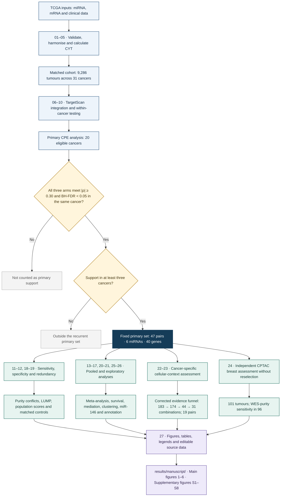

# Pan-cancer microRNA–gene associations with cytolytic activity

R code for the revised study of recurrent microRNA–gene associations with
tumour cytolytic activity (CYT), their sensitivity to immune composition,
and assessment in an independent CPTAC breast cancer cohort.

The analyses describe associations in bulk tumour tissue. Recurrence,
external association support, exploratory mediation and drug annotations
do not establish direct microRNA regulation or clinical utility.

## Study at a glance

| Component | Scope |
|---|---|
| Discovery cohort | 9,286 matched primary tumours across 31 TCGA cancer types |
| Primary analysis | CPE adjustment in 20 eligible cancer types |
| Fixed association set | 47 miRNA–gene pairs, six miRNAs and 40 genes |
| External assessment | CPTAC breast tumours: 101 samples; 96 with WES-derived purity |
| Interpretation | Immune-linked co-expression; no demonstrated target specificity |

## Analytical framework

Discovery is performed within individual cancer types. A predicted miRNA–gene
pair qualifies only when all three arms—miRNA–CYT, miRNA–gene and gene–CYT—meet
an absolute Spearman correlation of at least 0.30 and BH-FDR below 0.05 in
the same cancer, with support in at least three eligible cancers. CPE-adjusted
discovery defines the fixed primary set. LUMP and lower thresholds assess
sensitivity without redefining that set.

Both correlation signs are eligible under the absolute-effect rule. The
reported positive pooled associations represent co-expression, not proof of
repression or direct regulation. The fixed pairs are subsequently examined
for composition sensitivity, matched-control specificity and external
association support. Survival, mediation, clustering and conditional miR-146
analyses are exploratory.

Key reported observations:

- 47 recurrent pairs contribute 315 qualifying pair–cancer records.
- No evaluable pair retains recurrence after T-cell adjustment (0/44).
- No pair outperforms its correlation-matched non-target controls after BH correction.
- The corrected cellular-context funnel retains 31 combinations representing 19 pairs.
- The fixed set meets the three-arm effect/FDR criteria in 101 CPTAC breast tumours and in the 96-sample WES-purity sensitivity analysis.

These observations support reproducible immune-linked expression patterns.
They do not establish target-specific regulation, validated immune subtypes
or clinical prediction.

## Workflow

The diagram shows the scientific analysis sequence. The four branches all
start from the fixed primary set; external assessment does not select a new
set of pairs. Stage numbers refer to the current repository scripts.



**Eligibility:** CPE and LUMP are handled separately, with at least 30 samples
with valid purity and CYT within cancer. The primary set is defined under CPE;
LUMP and lower effect-size thresholds remain sensitivity analyses. BH families
are defined by the implemented cancer, arm, threshold and adjustment setting;
shared hypotheses are counted once.

**Execution:** the runner resolves dependencies from the stage registry.
The branches above group scientific analyses, not independent parallel jobs.
Stage 17 can be recomputed or imported from a compatible historical analysis
with the checked importer. Importing is recorded explicitly.

The editable diagram source is [docs/workflow.mmd](docs/workflow.mmd).

## Quick start

Use R 4.3.x for the closest match to the original R 4.3.1 analysis.
The code also supplies a package inventory rather than an empty or
unverified environment lockfile.

For a quick code check without biological data or Bioconductor installation:

```bash
Rscript scripts/install_dependencies.R --tests-only
Rscript tests/run_tests.R
Rscript scripts/run.R --dry-run
```

```bash
cd /path/to/PanCancer-miRNA-CYT
Rscript scripts/install_dependencies.R --install   # only if packages are missing
Rscript scripts/prepare_inputs.R --from=/path/to/original/MicroRNA
Rscript scripts/check_environment.R
Rscript tests/run_tests.R
Rscript scripts/run.R --dry-run
Rscript scripts/run.R --stages=1-27
```

If the original input files are unavailable, `prepare_inputs.R --download`
attempts public-source downloads and accepts them only if their SHA-256
digests match the original input allowlist. A changed or unavailable source
is reported as an error; reference hashes are never silently replaced.

For RStudio, open `PanCancer-miRNA-CYT.Rproj`, then:

```r
source("scripts/run.R")
run_pipeline(stages = 1:27)
```

All generated files use the stable `results/` directory. No uniquely named
run folder is required. The large TCGA expression matrices and TargetScan
archives are not part of the code archive.

## Continue after an error

For example, if stage 21 fails because a network service is unavailable:

```bash
Rscript scripts/run.R --stages=21-27
```

Or in RStudio:

```r
run_pipeline(stages = 21:27)
```

The runner verifies completed outputs before skipping them. To deliberately
rerun a completed stage, use `--force` or `force = TRUE`. Repeating a producer
marks its dependent analyses stale; unrelated branches are retained. Do not
edit generated tables to make a validation check pass. A running process
holds `results/manifests/execution.lock`; after a crash, remove that lock
only after confirming that the old process has ended.

Restarting means rerunning a failed stage from its beginning. It does not
resume inside a bootstrap or permutation loop. Failed partial outputs are
not accepted as completed results.

## Data sources and required inputs

Large source datasets are not included in Git. Input integrity is checked
against `config/FROM_SCRATCH_ALLOWED_INPUTS.tsv` before analysis.

| Resource | Required file or access route | Location |
|---|---|---|
| TCGA mRNA expression | `EB++AdjustPANCAN_IlluminaHiSeq_RNASeqV2.geneExp.xena` | `data/` |
| TCGA miRNA expression | `pancanMiRs_EBadjOnProtocolPlatformWithoutRepsWithUnCorrectMiRs_08_04_16.xena` | `data/` |
| Clinical endpoints | `Survival_SupplementalTable_S1_20171025_xena_sp` | `data/` |
| TargetScan predictions | `Predicted_Targets_Context_Scores.default_predictions.txt.zip` | `reference/targets/` |
| TargetScan seed families | `miR_Family_Info.txt.zip` | `reference/targets/` |
| MCP-counter signatures | `genes.txt`, `probesets.txt`, `SIGNATURE_MANIFEST.tsv` | Bundled under `reference/mcpcounter_signatures/` |
| Tumour purity | `Tumor.purity` dataset supplied through TCGAbiolinks | Loaded by the analysis |
| External breast cohort | CPTAC matched expression and purity inputs | Acquired by stage 24 |

Sources: [UCSC Xena](https://xenabrowser.net/),
[TargetScan 7.2](https://www.targetscan.org/vert_72/),
[LinkedOmics CPTAC breast data](https://www.linkedomics.org/data_download/CPTAC-pancan-BRCA/)
and [DGIdb](https://www.dgidb.org/).

For the closest input match, copy files from the original analysis with
`prepare_inputs.R --from=...`. Public downloads may change over time; a
hash mismatch must be investigated rather than bypassed. Package versions
used in the reference analysis are documented in
`docs/REFERENCE_PACKAGE_VERSIONS.tsv`.

## Analysis sequence

| Script | Analysis |
|---|---|
| 01–05 | Input validation, import, identifier harmonisation, CYT and eligibility |
| 06–10 | miRNA–CYT screening, target universe, three-arm testing, recurrence and purity adjustment |
| 11–12 | Purity-conflict exclusion and immune-composition sensitivity |
| 13 | Cross-cancer random-effects meta-analysis |
| 14–15 | Overall survival and DSS/PFI sensitivity |
| 16 | Exploratory within-cancer mediation |
| 17 | Clustering, stability and permutation-null calibration |
| 18 | Correlation-matched non-target controls |
| 19 | Seed-family and expression redundancy |
| 20–21 | Functional enrichment and DGIdb annotation |
| 22–23 | Cellular-context analysis and corrected evidence funnel |
| 24 | Fixed-pair external CPTAC breast cancer assessment |
| 25 | Incremental survival information of the fixed clusters |
| 26 | Conditional miR-146a/b analysis |
| 27 | Main/supplementary figures, tables, legends and count summaries |

The original, unexecuted quanTIseq stage is omitted. Consequently, the
original clustering stage 18 is now script 17. Historical producer IDs and
artifact basenames are retained internally so existing scientific table
schemas remain compatible; `config/stages.tsv` gives the exact mapping.
These historical IDs do not create separate output directories or prevent
restarting a stage.

## Stage-by-stage guide

### 01–05 — Cohort construction

Validate input files and configuration, record source hashes, harmonise TCGA identifiers, calculate CYT from the supplied GZMA and PRF1 expression values, and determine feature/cancer eligibility. Sample exclusions and purity conflicts are recorded.

**Outputs:** `results/processed/` and `results/tables/audit/`.

### 06–10 — Discovery and purity adjustment

Screen miRNA–CYT associations, map the TargetScan universe, test the three arms within each cancer and summarise recurrence. Retest the predicted-pair universe separately under CPE and LUMP adjustment at each configured threshold.

**Outputs:** `results/tables/primary/` and `results/tables/sensitivity/`.

### 11–12 — Purity conflicts and composition sensitivity

Repeat discovery after excluding purity-conflict samples. Evaluate the fixed primary set after separate adjustment for each immune/stromal population score, excluding gene–population marker overlap where required. Scores are not treated as measured cell fractions.

**Outputs:** `results/tables/sensitivity/`, `results/tables/downstream/` and audit tables.

### 13–16 — Pooled effects and exploratory outcome models

Estimate random-effects pooled correlations and heterogeneity, fit cancer-specific survival models and endpoint sensitivities, and estimate exploratory cross-sectional indirect effects. Mediation output does not establish causal ordering.

**Outputs:** `results/tables/downstream/` and `results/reports/`.

### 17–19 — Clustering, specificity and redundancy

Assess within-cancer-standardised clustering and its stability/null diagnostics. Compare predicted pairs with correlation-matched non-target genes. Examine seed-family overlap and redundancy. Clustering is internally descriptive.

**Outputs:** `results/tables/downstream/`, `results/tables/audit/` and reports.

### 20–23 — Annotation and cellular context

Annotate functional enrichment and database-listed drug–gene interactions. Evaluate cellular-context interactions and the corrected sequential evidence funnel. Drug annotations are not therapeutic recommendations.

**Outputs:** `results/tables/downstream/`, `results/figures/` and reports.

### 24 — External association assessment

Evaluate the fixed discovery pairs in CPTAC breast tumours without reselection, including WES-derived purity sensitivity and direction comparison against TCGA-BRCA. This does not validate pan-cancer recurrence or prognosis.

**Outputs:** `results/external_validation/`.

### 25–26 — Additional reviewer analyses

Test incremental cluster survival information beyond CYT and covariates, including PH diagnostics/time-varying sensitivity; estimate conditional miR-146a/b associations using shared complete cases and HC3 inference.

**Outputs:** `results/cluster_survival/` and `results/mir146/`.

### 27 — Figures and tables

Build main figures 1–6, supplementary figures S1–S8, main and supplementary tables, editable plot objects, legends, source tables and a count summary. This stage does not create a submission-formatted Word manuscript.

**Outputs:** `results/manuscript/`.

## Reuse the original expensive clustering calculation

Run stages 1–16 first. If the full original run directory and original
project code are accessible, import the completed original stage 18:

```bash
Rscript scripts/run.R --stages=1-16
Rscript scripts/import_clustering.R /path/to/PanCancer-miRNA-CYT \
  /path/to/original/MicroRNA/runs/from_scratch_20261017T061900.082
Rscript scripts/run.R --stages=18-27
```

The importer checks original completion, output hashes, scientific source
and helper hashes, configuration and all six clustering inputs. Analysis-ID
columns alone may differ between the original and current input tables;
other values and ordering must agree exactly. It copies the original outputs
byte-for-byte and records that they were **imported, not recomputed**.

Reports or plotted statistics alone cannot recover sample membership or the
full clustering result. A full verified clustering cache is not distributed with this code repository. If the full
original files cannot be recovered, run script 17 normally:

```bash
Rscript scripts/run.R --stages=17-27
```

The original clustering algorithm and its warning behaviour are retained.
Importing an old result does not resolve the previously observed
Quick-TRANSfer warnings in its null calculations.

## Inputs and external resources

Exact TCGA/Xena and TargetScan filenames, sizes and SHA-256 digests are in
`config/FROM_SCRATCH_ALLOWED_INPUTS.tsv`. MCP-counter signatures and their
original manifest are included. Purity uses `TCGAbiolinks::Tumor.purity`.
Functional enrichment uses the installed annotation databases; changing
their versions can change annotations. DGIdb is queried through its live
GraphQL API and therefore may return updated records on a later date.

Script 24 uses the four CPTAC files named in
`scripts/lib/stage25_external_validation.R`. To work offline, set
`STAGE25_CONFIG$local_external_dir` in `config/external_validation.R` to a
directory holding those original files. No reverse transformation of the
batch-adjusted TCGA matrix is introduced.

## Figures and tables

All drawing functions are in `scripts/figures/`; all stages and helpers are
under `scripts/`. Edit `config/figures.R` to change dimensions, type size,
palette, panel layouts or displayed rows. Then rerun stage 27 only:

```r
source("scripts/run.R")
run_pipeline(stages = 27, force = TRUE)
```

The plotting configuration includes display corrections aligned with the revised manuscript (population grouping, colour scales and panel dimensions). Script 27 produces Figures 1–6 and S1–S8, editable
legends, grouped supplementary workbooks/TSVs and supporting source tables.
Figure 1 uses the original Python/matplotlib drawing source and requires
Python with matplotlib (`python3 -m pip install matplotlib`). Its reported
cohort counts are fixed in the editable drawing source. The original SVG is
also retained in `reference/workflow/`. To export only the R-generated
figures, set `write_workflow = FALSE` in `config/figures.R`.

Outputs are written to `results/manuscript/`. Script 27 requires completed
current outputs from the integrated additional analyses. Archived reported
tables under `reference/reported_results/` are retained with their original
checksums for traceability; they are not a silent fallback for a new run.
The plotting checks deliberately reject inconsistent final counts or
incomplete tables instead of producing a superficially successful build.

## Structure

- `scripts/01_*.R` through `scripts/27_*.R`: ordered analyses and final exports.
- `scripts/lib/`: shared numerical functions and execution adapters.
- `scripts/figures/`: main/supplementary drawing and table functions.
- `config/`: unchanged scientific configuration, exclusions and input hashes;
  separate external-validation and figure settings.
- `tests/`: numerical, synthetic and restart/integrity tests.
- `docs/`: source mapping, migration audit and validation record.
- `data/`, `reference/`: source-data locations and reference material.
- `results/`: generated outputs, ignored by git.

## Validation and provenance

`tests/run_tests.R` checks the statistical helpers, HC3 calculations,
mediation aggregation, k-means diagnostics, cluster-survival comparisons,
conditional miR-146 models, external-validation primitives and the actual
restart/runtime guards. Optional real-data spot checks are reported as
skipped when not requested; they are not counted as successful data reruns.

The integrated pipeline was executed on Ubuntu with R 4.3.3. All 13 test
files passed. Stages 1–16 and 18–27 were executed; stage 17 clustering
outputs were imported from a compatible historical analysis through the
checked importer, rather than recomputed. Stage 27 reported 26 data-consistency
checks and 61 external-validation checks passing, together with cluster-survival
and conditional miR-146 consistency checks.

Selected external-validation and additional-analysis tables agree with the
archived reference tables within numerical comparison tolerances. This does
not claim bitwise identity of every file or an independent rerun of clustering.
The original reorganisation audit is retained in `docs/VALIDATION.md`; its
initial no-full-data-execution statement describes that earlier audit.

Source filenames and SHA-256 digests are recorded in `docs/SOURCE_MAP.tsv`.
The source-comparison audit distinguishes mechanical path/runner changes
from preserved numerical code. Generated artifacts retain configuration,
source, parent-input and output hashes in
`results/manifests/artifact_provenance.tsv`.

## Licence

The supplied source repository used the MIT licence; it is retained here.
Third-party datasets, signatures and annotations remain subject to their
respective source terms. Cite the study and the underlying data/software
resources when reusing the analyses.

## Code, data and generated files

Git tracks source code, configuration, documentation, tests and small bundled
reference materials. Large expression matrices, TargetScan ZIP archives,
generated results, local backups and logs are excluded by `.gitignore`.
Download or copy the original inputs with the preparation script; the SHA-256
checks reject changed source files. Ignoring a path does not remove an already
tracked file from Git history.

## Citation and contact

See [CITATION.cff](CITATION.cff) for citation metadata. This repository accompanies
“Recurrent microRNA–gene associations with tumour cytolytic activity and their
sensitivity to immune composition”. No publication DOI is asserted here.

---

## Authors and correspondence

| Author | Affiliation |
|---|---|
| Nazanin Bagherlou | Computational Pathology, Institute of Pathology, University Hospital Heidelberg, Heidelberg University, Germany |
| Shahram Aliyari | Computational Pathology, Institute of Pathology, University Hospital Heidelberg, Heidelberg University, Germany |
| Mobin Pirouzkhah | Cell Therapy and Haematopoietic Stem Cell Transplantation Research Centre, Tehran University of Medical Sciences, Iran |
| Zahra Salehi | Cell Therapy and Haematopoietic Stem Cell Transplantation Research Centre; Haematology, Oncology and Stem Cell Transplantation Research Centre, Tehran University of Medical Sciences, Iran |
| Cleo-Aron Weis | Computational Pathology, Institute of Pathology, University Hospital Heidelberg, Heidelberg University, Germany |

**Primary correspondence:** Shahram Aliyari — [aliyari.shahram@gmail.com](mailto:aliyari.shahram@gmail.com).  
**Co-correspondence:** Zahra Salehi — [zahra.salehi6463@yahoo.com](mailto:zahra.salehi6463@yahoo.com).
